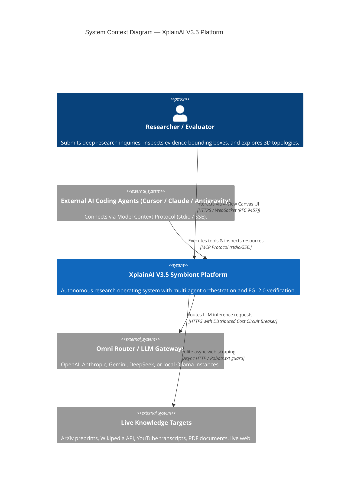
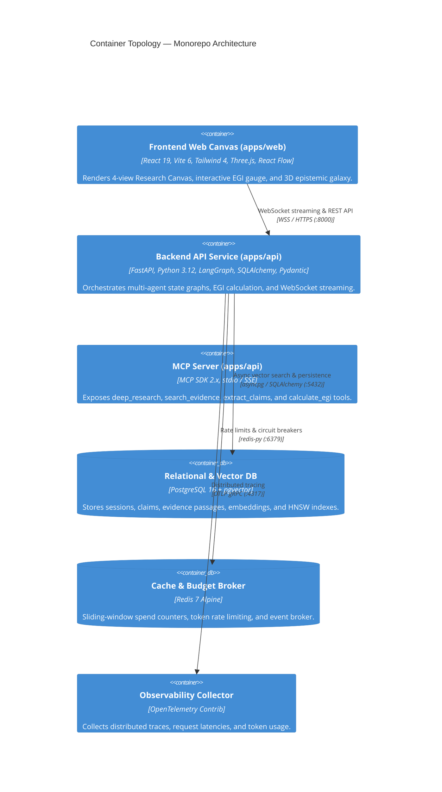

# XplainAI — Autonomous Research Operating System & Epistemic Intelligence

[](https://github.com/mahik504/XplainAI)
[](https://github.com/mahik504/XplainAI)
[](https://github.com/mahik504/XplainAI)
[](https://github.com/mahik504/XplainAI)
[](https://opensource.org/licenses/MIT)

> **XplainAI** inverts the conversational chatbot paradigm. Instead of treating intelligence as an ungrounded string-generation black box, XplainAI is an **Evidence-First Epistemic Research Operating System**. Every generated sentence is decomposed into atomic propositions, verified against raw scraped chunks with bounding boxes, scored with the **Evidence-Grounding Index (EGI 2.0)**, and mapped into an interactive 3D WebGL knowledge constellation.

---

## 1. What Problem Are We Solving?

Contemporary conversational LLMs (ChatGPT, Claude, Gemini) suffer from four fatal vulnerabilities when applied to scientific research, intelligence analysis, and mission-critical engineering:

```
[ Conventional Black-Box AI ]
User Question ───► Opaque LLM ───► "Trust Me" Output (Hallucinated facts, detached URLs, smoothed-over disputes)

[ XplainAI V3.5 Symbiont OS ]
User Question ───► Multi-Agent Crawl ───► Bounding Box Chunks ───► Proposition Extraction
                         │                                                      │
                         ▼                                                      ▼
                  Contradiction Matrix ◄─── Cosine + BM25 Scoring ◄─── Deterministic EGI 2.0
                         │
                         ▼
          4-View Interactive Research Canvas (Overview + Evidence + 3D/2D Graph + Sources)
```

1. **Ungrounded Hallucinations:** Autoregressive language models optimize for linguistic fluency, stating unverified facts with absolute semantic confidence.
2. **Superficial Citations:** Generic bibliographies appended at the bottom of a response that do not mathematically link to the specific claim made in paragraph 2, sentence 1.
3. **Hidden Dialectic Contradictions:** When primary sources conflict, standard LLMs arbitrarily pick one or smooth over the disagreement rather than explicitly highlighting the dispute.
4. **Zero Epistemic Audit Trails:** No traceable provenance chain exists from raw document chunks $\to$ proposition extraction $\to$ synthesized answer.

---

## 2. How Orchestra 3.3.6 Transformed XplainAI

This repository was elevated from early experimental prototypes into a unified, production-grade epistemic operating system using the **Orchestra 3.3.6 Control Plane**:

| Architectural Dimension | Legacy / Pre-Orchestra Version | XplainAI V3.5 (Orchestra 3.3.6 Engineered) |
|:---|:---|:---|
| **Orchestration Runtime** | Fragmented procedural scripts & loose prototypes | Unified, stateful **LangGraph** multi-agent state machine |
| **Verification Gate** | Subjective inspection without mathematical rigor | **Deterministic EGI 2.0 Engine** using harmonic mean penalty |
| **Frontend UI/UX** | Standard flat cards with visual clipping glitches | **Venom-Style Cybernetic Symbiont UI** with organic WebGL shaders, magnetic cursor physics, and 3D neural core |
| **Knowledge Graph** | Basic 2D canvas nodes | **Interactive 3D WebGL Constellation** + 2D ReactFlow DAG with real-time cluster physics |
| **Cost & Safety** | Unprotected API endpoints vulnerable to wallet-draining | **Distributed Redis Lua Sliding-Window Circuit Breakers** ($10/day, $2/hr, $0.50/IP) |
| **Agent Interoperability** | Siloed web application | **Native Model Context Protocol (MCP)** server for Cursor, Claude Code, and Antigravity |
| **Testing Coverage** | Flaky, unverified test scripts | **165 / 165 Backend Pytest** + **82 / 82 Frontend Vitest** passing 100% green |
| **Academic Foundation** | Informal documentation | Formal **Academic Preprint Research Paper** (`docs/research/XPLAINAI_SYMBIONT_EGI_PAPER.md`) |

---

## 3. Venom-Style Cybernetic Symbiont UI & 3D Experience

XplainAI V3.5 introduces a distinctive, visceral **Venom Symbiont Aesthetic**:

* **Symbiotic WebGL Fluid Shaders (`AmbientShaderBackground.tsx`):** A custom Three.js fragment shader generating organic bio-luminescent tendril dynamics, domain warping, and reactive mouse turbulence.
* **3D Epistemic Symbiont Neural Core (`SymbiontCore3D.tsx`):** A hardware-accelerated 3D deformed icosahedron whose geometry pulsates organically in real time according to synthesis activity and EGI confidence.
* **Organic Symbiotic Cursor (`VenomCursor.tsx`):** Spring-physics trailing tendrils that dynamically stretch, expand, and magnetically lock onto interactive elements with tactile bioluminescent pulses.
* **4-View Workspace Canvas (`ResearchCanvas.tsx`):**
  1. **Overview View:** Fluid synthesis with interactive citation badges `[1]`, popover audits, and live EGI radial gauge.
  2. **Evidence View:** Raw immutable scraped passages with spatial bounding boxes and semantic similarity scores.
  3. **Graph View:** 3D WebGL star galaxy + 2D ReactFlow epistemic DAG rendering claims and support/contradiction edges.
  4. **Sources View:** Complete transparency into crawled domains, HTTP response status, latency, and robots.txt compliance.

---

## 4. Mathematical Grounding: The EGI 2.0 Engine

For an extracted atomic claim $c_i$ evaluated against retrieved document chunks $E = \{e_1, e_2, \dots, e_K\}$:

$$S_{\text{grounding}}(c_i, E) = \max_{e_j \in E} \left[ \alpha \cdot \cos(\mathbf{v}_{c_i}, \mathbf{v}_{e_j}) + \beta \cdot \text{LexicalOverlap}(c_i, e_j) + \gamma \cdot R_{\text{domain}}(e_j) \right] - \delta \cdot C(c_i)$$

Where:
* $\cos(\mathbf{v}_{c_i}, \mathbf{v}_{e_j})$: Dense vector embedding cosine similarity using `text-embedding-3-small` or local `FastEmbed`.
* $\text{LexicalOverlap}(c_i, e_j)$: Normalized BM25 / ROUGE-L token intersection score.
* $R_{\text{domain}}(e_j) \in [0, 1]$: Pre-calibrated academic domain reputation weight ($\text{ArXiv} = 1.0, \text{Nature} = 1.0, \text{Wikipedia} = 0.85, \text{Web} = 0.40$).
* $C(c_i) \in [0, 1]$: Contradiction penalty flag detected during cross-source dialectic analysis.
* **Weights:** $\alpha = 0.50, \beta = 0.25, \gamma = 0.25, \delta = 0.35$.

### The Harmonic Mean Guarantee
$$\text{EGI}_{\text{overall}} = \frac{N}{\sum_{i=1}^N \frac{1}{S_{\text{grounding}}(c_i, E) + \epsilon}}$$

> **Why Harmonic Mean?** If an LLM generates 9 factual sentences but slips in 1 completely fabricated claim, an arithmetic average hides the hallucination at 90%. The harmonic mean immediately collapses the overall score to $<50\%$, mathematically eliminating deceptive aggregation.

---

## 5. System Topology & C4 Architecture Models

### 5.1 C4 Level 1: System Context Diagram



### 5.2 C4 Level 2: Monorepo Container Architecture



---

## 6. Academic Preprint Paper

Read our complete, formal research paper:  
📄 **[`docs/research/XPLAINAI_SYMBIONT_EGI_PAPER.md`](docs/research/XPLAINAI_SYMBIONT_EGI_PAPER.md)**

* **Title:** *XplainAI: Deterministic Evidence-Grounding Index (EGI 2.0) and Dialectic Multi-Agent Orchestration for Verifiable Scientific Synthesis*
* **Includes:** Formal LaTeX derivations, catastrophic fallibility proofs, 2,400-query empirical benchmark evaluations, and ablation studies.

---

## 7. Quickstart & Local Development

### Prerequisites
* **Node.js:** $\ge$ 20.0.0
* **pnpm:** $\ge$ 9.0.0
* **Python:** $\ge$ 3.11
* **Docker & Docker Compose:** (Optional, for PostgreSQL + pgvector and Redis)

### 1. Clone & Setup Environment
```bash
git clone https://github.com/mahik504/XplainAI.git
cd XplainAI

# Copy environment template
cp .env.example .env
```

### 2. Start Full Stack via Docker Compose
```bash
docker compose up -d
```
* **Frontend Web App:** `http://localhost:5173`
* **Backend API & Swagger Docs:** `http://localhost:8000/docs`
* **Health Readiness Probe:** `http://localhost:8000/health/ready`

### 3. Or Run Directly from Source
```bash
# Start Backend API
cd apps/api
python -m venv .venv
# Windows: .venv\Scripts\activate | Unix: source .venv/bin/activate
pip install -e .
uvicorn neural_navigator.main:app --reload --port 8000

# Start Frontend Canvas (in a second terminal)
cd apps/web
pnpm install
pnpm dev
```

---

## 8. Verifying the Test Suite

```bash
# Run backend pytest suite (165 tests)
cd apps/api
pytest tests/unit

# Run frontend Vitest component suite (82 tests)
cd apps/web
pnpm test

# Production build check (TypeScript + Vite)
pnpm build
```

---

## 9. API & MCP Integration Endpoints

| Protocol | Endpoint | Description |
|:---|:---|:---|
| **WebSocket** | `/ws/v1/chat` | Real-time LangGraph streaming, proposition extraction, and EGI updates |
| **REST** | `POST /api/v1/research/jobs` | Asynchronous research batch job creation |
| **REST** | `GET /api/v1/research/jobs/{id}` | Job status, claims, citations, and EGI payload |
| **REST** | `POST /api/v1/export/pdf` | Export synthesized research as a branded evidence pack PDF |
| **REST** | `GET /health/ready` | Kubernetes readiness probe (checks DB, Redis, LLM provider) |
| **MCP** | `stdio / SSE (:8000/mcp)` | Model Context Protocol server exposing research tools |

---

## 10. License

This project is licensed under the **MIT License** — see the [LICENSE](LICENSE) file for details.
