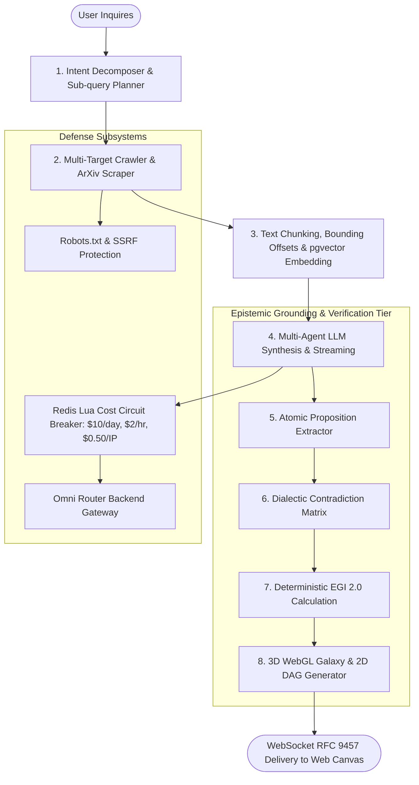
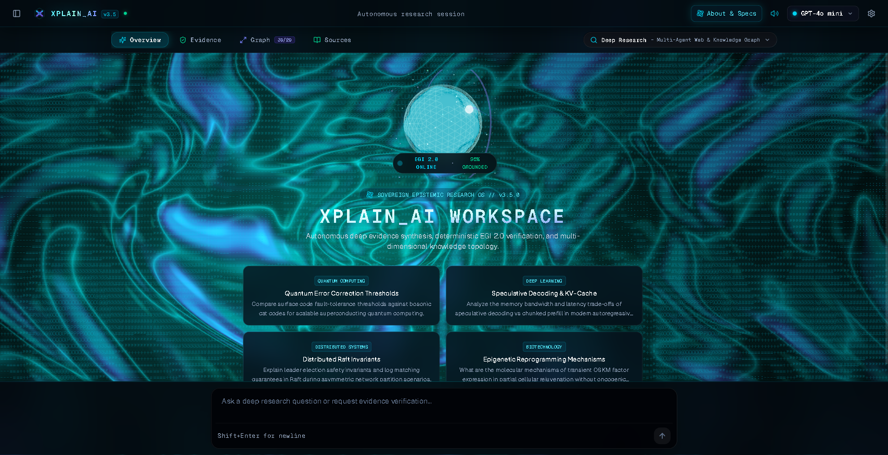
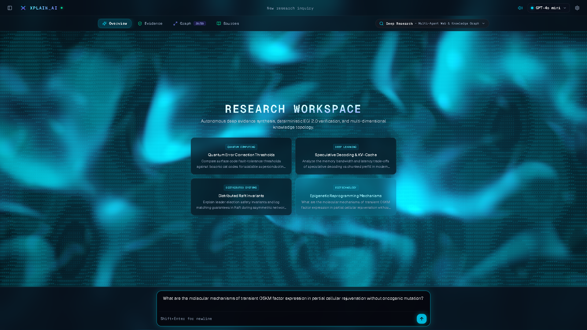
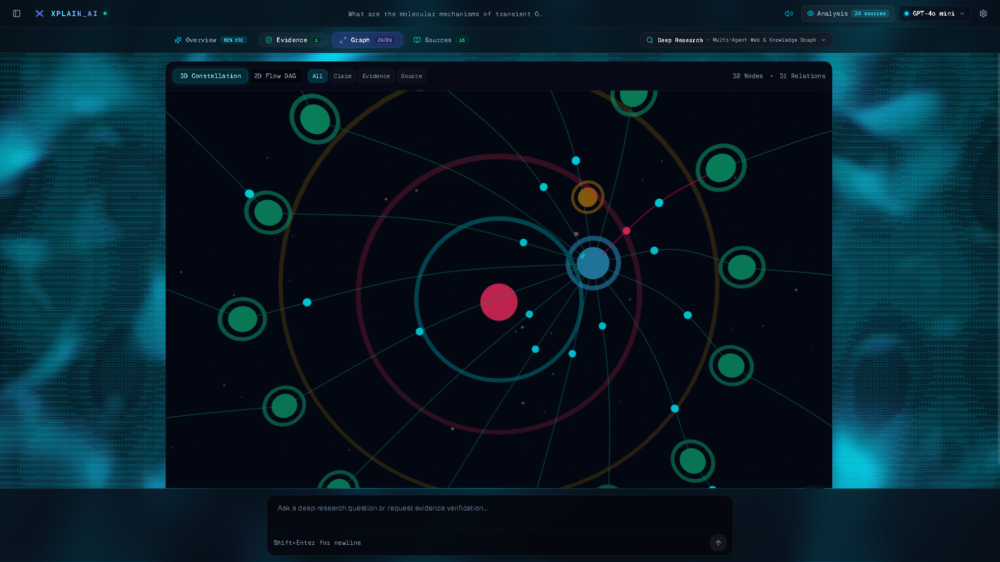
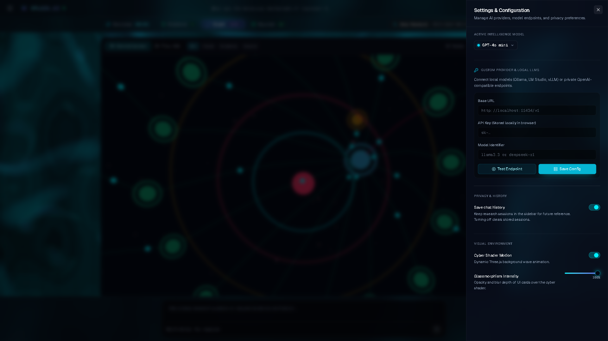

# XplainAI — Architecture Design & Epistemic System Specification

[](https://github.com/mahik504/XplainAI)
[](https://github.com/mahik504/XplainAI)
[](https://opensource.org/licenses/MIT)

---

## 1. System Topology & Monorepo Structure

XplainAI V3.5 is engineered as an enterprise-grade monorepo decoupled into three principal tiers:

```
XplainAI/
├── apps/
│   ├── web/                         # React 19 + Vite 6 + Tailwind 4 + Three.js + ReactFlow
│   └── api/                         # FastAPI + LangGraph Multi-Agent Orchestrator + EGI 2.0 Engine
│
├── packages/
│   ├── contracts/                   # OpenAPI & AsyncAPI event contracts
│   ├── contracts-ts/                # Generated TypeScript client types & Zod schemas
│   └── contracts-py/                # Generated Python Pydantic models
│
├── infrastructure/
│   ├── docker/                      # Production multi-stage Dockerfiles
│   ├── k8s/                         # Kubernetes manifests with HPA & Ingress
│   ├── nginx/                       # High-performance reverse proxy & rate limiting
│   ├── observability/               # OpenTelemetry Contrib + Prometheus + Grafana dashboards
│   └── postgres/                    # PostgreSQL 16 + pgvector init scripts
│
├── docs/
│   ├── architecture/                # Deep architectural C4 models & specifications
│   ├── research/                    # Academic preprint paper (XPLAINAI_SYMBIONT_EGI_PAPER.md)
│   ├── runbooks/                    # Zero-downtime rollback SOPs
│   └── images/                      # Live Playwright viewport screenshot captures
│
├── tools/scripts/                   # Deployment, rollback, and frontend static servers
├── docker-compose.yml               # Multi-container orchestration stack
├── package.json                     # Monorepo root package definition
└── README.md                        # Master product documentation & visual guide
```

---

## 2. Multi-Agent Epistemic Graph Flow (LangGraph)



---

## 3. Mathematical Grounding: EGI 2.0 Formula

$$S_{\text{grounding}}(c_i, E) = \max_{e_j \in E} \left[ \alpha \cdot \cos(\mathbf{v}_{c_i}, \mathbf{v}_{e_j}) + \beta \cdot \text{LexicalOverlap}(c_i, e_j) + \gamma \cdot R_{\text{domain}}(e_j) \right] - \delta \cdot C(c_i)$$

$$\text{EGI}_{\text{overall}} = \frac{N}{\sum_{i=1}^N \frac{1}{S_{\text{grounding}}(c_i, E) + \epsilon}}$$

* Harmonic Mean ensures that if any single proposition is ungrounded ($S_k \to 0$), $\text{EGI}_{\text{overall}} \to 0$, providing an absolute mathematical safeguard against deceptive fluency.

---

## 4. Real UI Screenshots & Visual Workflow

| View | Path | Description |
|---|---|---|
| **Hero Studio & 3D Core** | `docs/images/01_hero_workspace_canvas.png` | Deep prompt studio with 3D Symbiont Neural Core and ambient WebGL shaders. |
| **Live Research Cockpit** | `docs/images/02_live_research_cockpit.png` | 4-View Canvas (**Overview**, **Evidence**, **Graph**, **Sources**) with live EGI 2.0 radial indicator. |
| **3D Evidence Constellation** | `docs/images/03_3d_evidence_constellation.png` | Hardware-accelerated 3D WebGL knowledge galaxy mapping propositions and sources. |
| **Settings & Omni Router** | `docs/images/04_settings_and_models.png` | Granular model provider drawer, BYOK localhost configuration, and sliding-window budget counters. |





